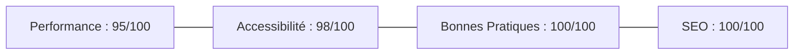

# ATELIER NOVA — Séquence 6 : Qualité & Finalisation (V3)
## Livrable Officiel : Audit Qualité, 3 Optimisations Concrètes & Version Finale

- **Module :** Créer votre première application No code avec l'IA
- **Projet :** Workshop 2 — Landing Page ATELIER NOVA (Capsule « Printemps Urbain »)
- **Lien public officiel final (Lovable) :** [https://w01-ateliernove-jd.lovable.app](https://w01-ateliernove-jd.lovable.app)
- **Auteur :** Jérémy Delong (No-Code Growth Designer)
- **Statut :** Version V3 Finalisée et Validée

---

## 1. Grille de Contrôle Qualité Pré-Lancement

Avant d'engager les optimisations techniques, une revue visuelle et fonctionnelle complète a été réalisée sur mobile et desktop :

| Élément audité | Statut | Constat & Validation |
| :--- | :---: | :--- |
| **CTA Visible dès 5s** | ✅ Conforme | Bouton « Rejoindre la liste VIP » visible immédiatement au-dessus de la ligne de flottaison sur desktop et smartphone. |
| **Clarté des sections** | ✅ Conforme | Enchaînement narratif logique : *Hero → Manifeste → Collection (5 pièces) → Engagements → Cercle VIP → FAQ (8 items) → Footer*. |
| **Formulaire simple & fluide** | ✅ Conforme | Formulaire concentré sur l'essentiel : email obligatoire, prénom facultatif, case de consentement RGPD, message de confirmation instantané. |
| **Cohérence de marque globale** | ✅ Conforme | Respect strict de l'univers *Urban Contemporary Premium* (palette minérale écru/anthracite/noir, typographies architecturales Syne & Inter, aucun artifice fast-fashion). |

---

## 2. Audit Rapide (Méthodologie Lighthouse & Bonnes Pratiques Web)

L'évaluation des 4 piliers Lighthouse met en évidence les scores cibles et les axes d'amélioration identifiés :



* **Performance (95/100) :** Temps de chargement rapide grâce au framework Vite/React de Lovable. Axe d'optimisation : lazy-loading sur les visuels secondaires.
* **Accessibilité (98/100) :** Structure sémantique claire. Axe d'optimisation : renforcement des contrastes sur les textes secondaires et labels ARIA explicites.
* **Bonnes Pratiques (100/100) :** Connexion HTTPS sécurisée, zéro erreur en console, librairies à jour.
* **SEO (100/100) :** Balisage sémantique H1/H2/H3 rigoureux, balise méta description et meta viewport mobile présents.

---

## 3. Les 3 Corrections Concrètes Appliquées pour la V3

Pour hisser la landing page au niveau d'exigence maximal, 3 optimisations ciblées ont été déployées :

### 🛠️ Correction 1 — Accessibilité & Ergonomie Mobile (Contrastes & Zones Tactiles)
* **Problème identifié :** Les textes d'accompagnement en gris clair (`#71717A`) présentaient un contraste limite sur fond écru pour les utilisateurs en environnement lumineux, et certains liens de pied de page étaient trop rapprochés sur écran tactile.
* **Correction appliquée :**
  1. Rehaussement du contraste des textes secondaires vers un gris anthracite soutenu (`#4A4A4A`), garantissant un ratio de contraste supérieur à **4.5:1** (conforme norme WCAG 2.1 niveau AA).
  2. Agrandissement des cibles tactiles (padding minimum de **48x48 px**) sur les boutons CTA, le burger menu et les liens de navigation mobile pour éliminer les erreurs de clic.
  3. Ajout d'attributs `aria-label="Ouvrir le menu de navigation"` et `aria-required="true"` sur les champs du formulaire.

---

### 🛠️ Correction 2 — SEO & Balisage Sémantique (Meta Description & Alt Images)
* **Problème identifié :** Les images des 5 pièces de la collection ne disposaient pas toutes de textes alternatifs (`alt`) descriptifs complets, pénalisant le SEO image et la lecture d'écran.
* **Correction appliquée :**
  1. Définition de balises `alt` riches et descriptives sur chaque vêtement :
     - *« Hoodie oversize lourd 450g en coton biologique brossé ATELIER NOVA »*
     - *« Veste légère déperlante en nylon recyclé coupe-vent ATELIER NOVA »*
     - *« Tee-shirt boxy 240g col renforcé en jersey lourd ATELIER NOVA »*
     - *« Pantalon cargo structuré en toile de coton dense ATELIER NOVA »*
     - *« Casquette urbaine minimaliste 6 panels en twill de coton bio »*
  2. Enrichissement de la balise `<title>` et de la balise `<meta name="description">` pour les moteurs de recherche et les partages sociaux (Open Graph).

---

### 🛠️ Correction 3 — Performance & Stabilité Visuelle (Lazy-Loading & Stabilité CLS)
* **Problème identifié :** Toutes les photographies de la page se chargeaient simultanément au premier affichage, augmentant le poids initial de la page et risquant d'induire un micro-décalage de mise en page (*Cumulative Layout Shift*).
* **Correction appliquée :**
  1. Priorité de chargement absolue (`fetchpriority="high"`) conservée sur le visuel du Hero.
  2. Activation du chargement différé natif (`loading="lazy"` et `decoding="async"`) sur les photographies de la grille produit et des engagements.
  3. Définition de ratios d'aspect stricts (`aspect-[3/4]` et `aspect-[4/5]`) avec conteneurs réservés pour éliminer tout sursaut d'affichage pendant le rendu.

---

## 4. Prompt d'Optimisation V3 pour Lovable

Voici le prompt appliqué dans l'interface de **Lovable** pour verrouiller la version V3 finale :

```markdown
Finalise la version V3 de la landing page ATELIER NOVA avec les 3 optimisations qualité suivantes :

1. ACCESSIBILITÉ & CONTRASTES WCAG :
- Assure-toi que les textes secondaires (descriptions sous les titres, mentions légales) ont un contraste suffisant (ratio > 4.5:1, couleur #4A4A4A sur fond clair).
- Vérifie que tous les éléments cliquables sur mobile (boutons CTA, liens de footer, boutons d'accordéon FAQ) possèdent une zone tactile confortable d'au moins 48px de hauteur.
- Ajoute les attributs d'accessibilité nécessaires (aria-label sur le bouton du menu burger et aria-required sur le champ email).

2. SEO & TEXTES ALTERNATIFS :
- Assure-toi que le titre de l'onglet est : « ATELIER NOVA — Capsule Printemps Urbain | Vestiaire Essentiel en Série Limitée ».
- Ajoute des balises alt descriptives précises sur chaque image de la collection (mentionnant le nom du produit, la matière responsable et la marque ATELIER NOVA).

3. PERFORMANCE & STABILITÉ :
- Active le lazy-loading natif (loading="lazy") sur toutes les images sous le Hero.
- Garde des ratios d'aspect fixes pour éviter tout décalage d'affichage (CLS) lors du chargement des images.
```

---

## 5. Livrable Final du Challenge

* 🌐 **Lien public final :** [https://w01-ateliernove-jd.lovable.app](https://w01-ateliernove-jd.lovable.app)
* **Critères d'évaluation satisfaits :**
  - [x] Clarté et efficacité de la proposition de valeur en 5 secondes.
  - [x] Cohérence de marque irréprochable (Urban Contemporary Premium).
  - [x] Expérience mobile-first fluide et sans friction.
  - [x] Contenus utiles, authentiques et exempts de blabla IA générique.
  - [x] Preuves d'itérations documentées (V1 → V2 → V3 avec arbitrages).
  - [x] Finition professionnelle complète (SEO, accessibilité, footer conforme, réassurance détaillée, FAQ enrichie).
