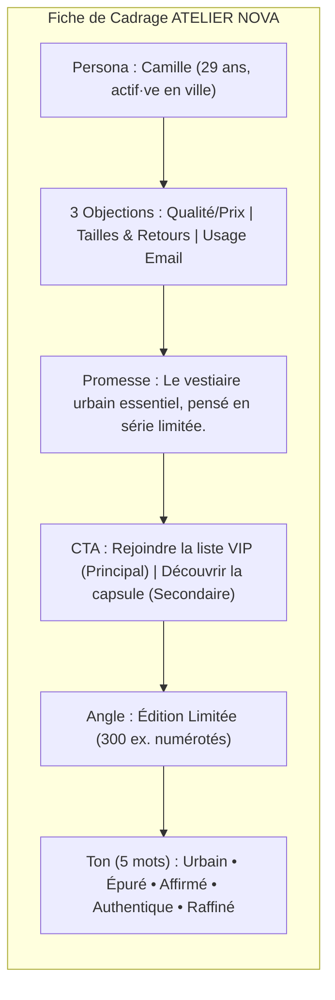

# Journal IA — Séquence 2 : Cadrer la campagne ATELIER NOVA (Cible + Promesse)

- **Auteur :** Jérémy Delong
- **Rôle :** No-Code Growth Designer
- **Projet :** Lancement de la capsule « Printemps Urbain » — ATELIER NOVA
- **Document de référence :** Fiche de cadrage validée du 20.10.2026

---

## 1. Démarche Méthodologique & Objectifs du Cadrage

Dans cette séquence, l'objectif est d'utiliser l'IA comme un **partenaire de réflexion stratégique** pour définir les fondations de la landing page, sans « laisser faire l'IA » à l'aveugle. 

Pour garantir une cohérence parfaite et éviter les hallucinations marketing, la règle d'or a été appliquée :
1. **Un seul fil de conversation continu** pour que l'IA conserve l'historique du brief et du persona.
2. **Chaînage de 3 prompts spécialisés** (Persona/Objections → Propositions de valeur/CTA → Assemblage et arbitrage).
3. **Contrôle humain systématique :** trier, élaguer le blabla, choisir et affiner.

---

## 2. Étape 1 : Définition du Persona & Levée des Objections

### 📌 Prompt 1 envoyé à l'IA
```text
Tu es stratège de marque. Voici le challenge (le cahier des charges) :
"""
ATELIER NOVA prépare le lancement d'une capsule « Printemps Urbain ».
Marque urbaine premium : matières responsables, production en série limitée, style minimaliste et polyvalent.
Pièces phares : hoodie, tee-shirt, veste légère, pantalon cargo, accessoires.
Objectif : tester l'intérêt du marché via des inscriptions à une liste VIP (accès anticipé).
"""
À partir de ce challenge, et uniquement de lui :
- Propose UNE persona pour cette campagne : qui elle est, ce qu'elle veut, son contexte (3 à 5 lignes).
- Puis liste ses 3 objections à l'achat, de façon réaliste.
Ne vends rien : décris honnêtement. Reste fidèle au challenge.
```

### 🤖 Proposition brute de l'IA
> **Persona proposé :** Camille, 29 ans, consultante ou cadre créative vivant dans une grande métropole (Paris/Lyon). Elle privilégie une garde-robe fonctionnelle et épurée pouvant alterner entre télétravail, bureau et sorties du week-end. Elle est saturée par la fast-fashion et cherche des marques transparentes qu'elle découvre sur Instagram.  
> **3 Objections identifiées par l'IA :**  
> 1. *Prix vs Justification :* Est-ce que le positionnement "premium responsable" justifie réellement un prix plus élevé, ou s'agit-il de greenwashing ?  
> 2. *Risque taille & logistique :* En achetant une marque en ligne en pré-lancement, comment être sûre du taillage et des modalités de retours ?  
> 3. *Collecte de données :* Pourquoi donner mon email maintenant si la boutique n'est pas encore ouverte ? Vais-je être spammée ?

### ✍️ Ce que j'ai gardé et modifié
* **Ce que j'ai gardé :** Le profil de Camille est crédible, précis et correspond exactement à la cible citadine active. Les 3 objections ciblent les vrais points de friction (prix/qualité, retours/tailles, légitimité de l'email).
* **Ce que j'ai modifié :** J'ai simplifié la description pour la rendre non binaire (*actif·ve*) et accentué son besoin impératif de transparence avant toute conversion.

---

## 3. Étape 2 : Propositions de Valeur & Calls to Action (CTA)

### 📌 Prompt 2 envoyé à l'IA
```text
Toujours à partir du challenge ci-dessus et de la persona retenue (Camille, 29 ans) :
Propose 3 propositions de valeur : 1 courte (pour l'accroche), 2 détaillées (pour la section « pourquoi »).
Pour chacune, propose 2 CTA possibles (1 principal, 1 secondaire).
Appuie-toi sur la promesse du challenge (matières responsables, série limitée, style premium). Varie le ton. Numérote.
Je choisirai et j'améliorerai.
```

### 🤖 Propositions de l'IA & Analyse critique

1. **Piste 1 (Angle Éco-responsabilité) :**
   * *Accroche :* « La mode urbaine qui respecte la planète. »
   * *CTA :* « Rejoindre le mouvement » / « Découvrir notre impact »
   * *Mon analyse :* ❌ Trop cliché, risque d'être perçu comme une leçon de morale écologique par Camille.
2. **Piste 2 (Angle Rareté / Drop) :**
   * *Accroche :* « Édition ultra-limitée : réservez votre pièce avant rupture. »
   * *CTA :* « Réserver mon accès prioritaire » / « Voir les stocks »
   * *Mon analyse :* ⚠️ Trop agressif, crée une fausse urgence (*FOMO*) peu compatible avec l'ADN premium.
3. **Piste 3 (Angle Vestiaire Essentiel & Série Limitée - Retenue) :**
   * *Accroche courte :* « Le vestiaire urbain essentiel, pensé en série limitée. »
   * *Accroche longue :* « Printemps Urbain rassemble des pièces minimalistes et polyvalentes, conçues pour accompagner le quotidien en ville. Une capsule en série limitée, portée par une sélection de matières dans une démarche responsable. Inscrivez-vous pour découvrir son lancement en avant-première. »
   * *CTA proposés :* « Rejoindre la liste VIP » (principal) / « Découvrir la capsule » (secondaire).
   * *Mon analyse :* ✅ Parfait équilibre entre style, utilité quotidienne et authenticité de la démarche.

---

## 4. Étape 3 : Assemblage et Arbitrage de la Fiche Cadrage

### 📌 Prompt 3 envoyé à l'IA
```text
Regroupe tout en une fiche Cadrage claire et courte, fidèle au challenge :
- Persona
- Objections (3)
- Promesse (pour qui / quoi / bénéfice / preuve)
- CTA (principal + secondaire)
- Angle (un seul : édition limitée / responsable / premium)
- Ton de marque (5 mots)
Garde UN SEUL angle et CINQ mots de ton. Formule court.
C'est moi qui validerai et ajusterai.
```

### ⚖️ Mes Arbitrages & Décisions Stratégiques
* **Choix de l'Angle unique :** **ÉDITION LIMITÉE**.  
  *Justification :* C'est le seul angle qui justifie naturellement la collecte d'emails pour une liste VIP (accès anticipé avant épuisement des stocks), sans inventer de promotion tarifaire agressive.
* **Choix des 5 mots de ton :** **URBAIN / ÉPURÉ / AFFIRMÉ / AUTHENTIQUE / RAFFINÉ**.  
  *Justification :* Exclut le verbiage prétentieux du luxe traditionnel tout en conservant une posture haut de gamme et contemporaine.

---

## 5. Synthèse Finale : Fiche de Cadrage Validée



### 📋 Contenu Officiel de la Fiche

| Section | Éléments validés |
| :--- | :--- |
| **01. Objectif** | Capter des inscriptions VIP pour un accès anticipé à une capsule de vêtements urbains premium, en série limitée, minimalistes et polyvalents, avec une sélection de matières responsables. |
| **02. Persona** | **Camille, 29 ans**, actif·ve en ville, cherche des pièces élégantes et polyvalentes pour le travail et les sorties ; sensible à la qualité et à l'achat réfléchi ; découvre des marques sur Instagram ; attend de la transparence avant de laisser son email. |
| **03. Objections** | 1. Le rapport qualité-prix est-il justifié ?<br>2. Comment choisir la bonne taille, quelles modalités de livraison et de retour ?<br>3. Pourquoi laisser mon email avant l'ouverture et comment sera-t-il utilisé ? |
| **04. Promesse** | **Courte :** *« Le vestiaire urbain essentiel, pensé en série limitée. »*<br>**Longue :** *« Printemps Urbain rassemble des pièces minimalistes et polyvalentes, conçues pour accompagner le quotidien en ville. Une capsule en série limitée, portée par une sélection de matières dans une démarche responsable. Inscrivez-vous pour découvrir son lancement en avant-première. »* |
| **05. CTA** | **Principal :** « Rejoindre la liste VIP »<br>**Secondaire :** « Découvrir la capsule » |
| **06. Angle & Ton** | **Angle retenu :** ÉDITION LIMITÉE *(justification : cohérent avec le pré-lancement, premium par le design, responsabilité prouvée sans greenwashing)*.<br>**Ton de marque (5 mots) :** URBAIN / ÉPURÉ / AFFIRMÉ / AUTHENTIQUE / RAFFINÉ. |

---

## 6. Retour d'Expérience & Apprentissages sur le Cadrage IA

1. **L'IA comme miroir critique :** L'exercice a montré que si l'on ne cadre pas fermement le prompt, l'IA a tendance à proposer des promesses généralistes et du greenwashing (« sauver la planète »). 
2. **La contrainte génère la qualité :** Imposer un *seul persona*, un *seul angle* et *5 mots de ton* a forcé des choix marketing tranchés qui ont servi de boussole directe pour les Séquences 3, 4 et 5.
3. **Alignement total :** Ce document en Markdown reflète fidèlement le PDF de cadrage officiel déposé le 20.10.2026.
