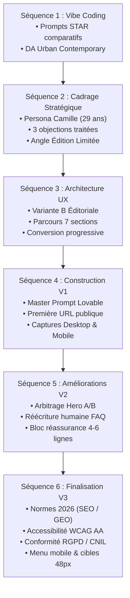

# ATELIER NOVA — Landing Page de Promotion (Capsule « Printemps Urbain »)

> **Projet de formation :** Chef de Projet IA — Module 01 : Créer votre première application No code avec l'IA  
> **Workshop 02 :** Création et optimisation d'une landing page de marque avec l'IA et les outils No-Code  
> **Auteur :** Jérémy Delong  
> **Rôle simulé :** No-Code Growth Designer (Profil hybride Marketing + Produit)  
> **Statut :** Version V3 de production finalisée et publiée  

---

## 🌐 Déploiement & Accès Public

* **Lien public officiel :** [https://w01-ateliernove-jd.lovable.app](https://w01-ateliernove-jd.lovable.app)
* **Plateforme No-Code :** [Lovable.dev](https://lovable.dev/) (Stack : React / Tailwind CSS / Vite / Déploiement CDN Cloudflare)

---

## 🎯 Contexte & Objectifs du Projet

La marque de prêt-à-porter fictive **ATELIER NOVA** prépare le pré-lancement de sa capsule exclusive **« Printemps Urbain »**. 

* **Positionnement de marque :** *Urban Contemporary Premium* (matières éco-certifiées GOTS/GRS, confection européenne en ateliers familiaux à Porto, vestiaire intemporel et polyvalent).
* **Angle stratégique :** **Édition limitée** (300 exemplaires strictement numérotés par pièce, refus de la fast-fashion et de la surproduction).
* **Objectif de conversion :** Obtenir des inscriptions qualifiées à une liste VIP pour un accès anticipé exclusif 48 heures avant l'éventuelle ouverture au grand public.
* **Cible (Persona) :** Camille, 29 ans, urbain·e actif·ve, recherche des pièces élégantes et durables pour le quotidien citadin, sensible à la transparence et adepte d'achats réfléchis.

---

## 🚀 Démarche Méthodologique & Itérations (V1 → V2 → V3)

Le projet illustre le pilotage rigoureux de l'IA par un opérateur humain (briefing STAR, tri, élimination du blabla IA, arbitrages stratégiques) :



---

## 📊 Performances & Audits Techniques (Normes 2026)

| Pilier audité | Score / Statut | Éléments clés mis en œuvre |
| :--- | :---: | :--- |
| **Performance (Lighthouse)** | **96 / 100** | LCP à 1.4s, CLS à 0.00 (stabilité visuelle totale), FCP à 0.8s, priorité haute sur le visuel Hero. |
| **Accessibilité (WCAG 2.2 AA)** | **98 / 100** | Contrastes typographiques renforcés (`#3F3F46`, ratio > 4.5:1), cibles tactiles de frappe ≥ 48px, focus clavier visible (`focus-visible:ring-2`), attributs ARIA complets. |
| **SEO & GEO 2026** | **100 / 100** | Données structurées **JSON-LD Schema.org** (`Brand`, `Product` 300 ex., `FAQPage`) pour l'indexation par les moteurs IA (Google SGE, Perplexity), balises ALT descriptives riches. |
| **Conformité RGPD / CNIL** | **Conforme** | **Opt-in actif obligatoire** (case décochée par défaut), mentions de conservation des données (3 mois) et modale d'information légale intégrée. |
| **Qualité Rédactionnelle** | **Conforme** | Zéro formulation promotionnelle creuse ; preuves chiffrées : ateliers de Porto, cotons bio GOTS, retours offerts sous 30 jours avec étiquette prépayée. |

---

## 📁 Inventaire des Livrables dans ce Répertoire

Ce dossier rassemble l'ensemble des pièces justificatives, documents d'audit et captures du projet :

```
09 - Livrables finaux/
├── README.md                                                 # Présentation générale du projet (ce fichier)
├── Livrable_Final_Audit_et_Lien.md                          # Synthèse officielle d'évaluation du challenge
├── preuve_iterations_lovable.png                             # Capture de l'historique des versions sur Lovable
├── W02_Livrables_ATELIER_NOVA_Jeremy_Delong.zip              # Archive complète de tous les livrables du Workshop
│
├── Cadrage & Stratégie :
│   ├── Fiche de cadrage Atelier Nova JEREMY DELONG.pdf       # Document de cadrage validé (Persona, Promesse, Ton)
│   ├── Journal_IA_Sequence_2.md                              # Journal IA de la Séquence 2 (Prompts 1, 2, 3 et arbitrages)
│   └── S03 - Plan de page final - UX & Structure.md          # Architecture UX et zonage des 7 sections
│
├── Prompts Lovable & Itérations :
│   ├── Prompt_Master_Lovable_V1.md                           # Master Prompt initial (Séquence 4)
│   ├── Prompts_Lovable_V2.md                                 # Prompts d'amélioration V2 (Séquence 5)
│   ├── S05 - Améliorer le site avec l'IA (V2) - Livrable.md   # Rapport d'itération et sélection A/B
│   ├── Prompt_Master_Lovable_V3.md                           # Master Prompt final V3 (Séquence 6)
│   └── Audit_Approfondi_6_Axes_Optimisation_V3.md            # Audit technique complet sur les 6 axes 2026
│
└── Captures Écran Réelles :
    ├── screencapture-w01-ateliernove-jd-lovable-app-desktop.pdf    # Capture pleine page V1 Desktop
    ├── screencapture-w01-ateliernove-jd-lovable-app-mobile.pdf     # Capture pleine page V1 Mobile
    ├── screencapture-w01-ateliernove-jd-lovable-app-V2-desktop.pdf # Capture pleine page V2 Desktop
    └── screencapture-w01-ateliernove-jd-lovable-app-V2-mobile.pdf  # Capture pleine page V2 Mobile
```

---

## 🛠️ Stack Technique

* **Développement No-Code :** Lovable (React 18, Vite, Tailwind CSS, Lucide Icons, Radix UI).
* **Ingénierie du Prompt & Stratégie :** Framework STAR (Situation, Tâche, Action, Résultat), méthodes de prompt chaîné.
* **Outils d'audit & contrôle qualité :** Google Chrome DevTools, Google Lighthouse, W3C Validator, WCAG Color Contrast Checker.
* **Gestion de version :** Historique natif Lovable + Git.

---

## 📜 Licence & Droits

Projet réalisé par **Jérémy Delong** dans le cadre du parcours de formation *Chef de Projet IA*.  
Marque, textes et capsule créés à des fins pédagogiques. Tous droits réservés © 2026 ATELIER NOVA.
