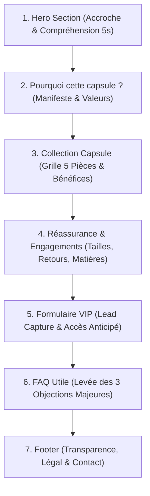

# ATELIER NOVA — Séquence 3 : UX & Structure de la Landing Page
## Livrable : Plan de page final (Structure, Variantes & Objectifs UX)

> **Projet :** Lancement de la capsule « Printemps Urbain »  
> **Cible (Persona Séquence 2) :** Camille, 29 ans, urbain·e actif·ve, adepte d'achats réfléchis, besoin de transparence avant inscription  
> **Promesse retenue :** *« Le vestiaire urbain essentiel, pensé en série limitée. »*  
> **Angle & Ton :** Édition limitée | Urbain / Épuré / Affirmé / Authentique / Raffiné  
> **Direction Artistique (Séquence 1) :** Urban Contemporary Premium  

---

## 1. Comparaison de 2 Variantes de Structure

Pour répondre à l'objectif de pré-lancement (collecte de leads VIP qualifiés), deux logiques d'architecture UX ont été explorées :

| Critères | Variante A : Structure Directe (Fast Teaser) | Variante B : Structure Éditoriale (Réassurance Progressive) |
| :--- | :--- | :--- |
| **Philosophie UX** | Mobile-first rapide, friction minimale, conversion immédiate. | Narration progressive, construction du désir, levée méthodique des objections. |
| **Parcours utilisateur** | *Découvrir → Désirer → S'inscrire → (Détails secondaires)* | *Découvrir → Comprendre → Désirer → Être rassuré → S'inscrire* |
| **Ordre des sections** | 1. Hero (avec champ email direct) 2. Produits (aperçu rapide 4 pièces) 3. Pourquoi (mini-bloc) 4. Réassurance (3 pictos) 5. FAQ courte (4 questions) 6. Footer | 1. Hero (impact visuel + promesse + CTA scroll) 2. Pourquoi (manifeste anti-fast fashion) 3. Produits (grille 5 pièces + bénéfices matières) 4. Réassurance (guide tailles, retours, traçabilité) 5. Formulaire VIP (bloc dédié immersif) 6. FAQ (8 questions ciblant les objections) 7. Footer |
| **Forces** | Taux de scroll minimal, action proposée dès le 1er écran. | Crédibilité maximale, valorisation du positionnement premium et de l'édition limitée. |
| **Limites** | Trop abrupte pour Camille : n'apaise pas ses 3 objections préalables (qualité/prix, tailles/retours, usage des données). | Nécessite un rythme éditorial soigné pour maintenir l'attention jusqu'au formulaire. |

### Choix retenu : Variante B (Structure Éditoriale & Réassurance Progressive)
* **Justification stratégique :** Camille ne laisse pas son email sur une promesse superficielle. L'angle de la marque repose sur la **qualité des matières** et la **série limitée**. Placer le formulaire après la découverte des pièces et les éléments de réassurance permet de maximiser la valeur perçue et le taux de conversion réel d'une audience qualifiée.

---

## 2. Plan de Page Final : Définition Section par Section

Structure détaillée intégrant les 7 sections obligatoires du cahier des charges, enrichies des arbitrages des Séquences 1 & 2 :

---

### Section 1 : Hero Section
* **Objectif UX :** Capter immédiatement l'attention (règle des 5 secondes) : faire comprendre qu'il s'agit d'une capsule de mode urbaine premium en série limitée et inciter à l'action.
* **Contenu attendu (1–2 lignes) :**  
  *Grand visuel éditorial urbain multi-silhouettes, titre H1 « Le vestiaire urbain essentiel, pensé en série limitée », sous-titre explicatif et bouton CTA principal « Rejoindre la liste VIP » (avec ancre vers le formulaire).*

---

### Section 2 : Pourquoi cette capsule ? (Le Manifeste)
* **Objectif UX :** Créer une connexion émotionnelle et rationnelle avec Camille en opposant la fast-fashion éphémère à l'approche réfléchie, durable et locale d'ATELIER NOVA.
* **Contenu attendu (1–2 lignes) :**  
  *Un court texte manifeste expliquant le refus de la surproduction, accompagné de 3 piliers visuels : matières responsables sourcées, coupe intemporelle et confection en série numérotée.*

---

### Section 3 : Produits (La Capsule « Printemps Urbain »)
* **Objectif UX :** Matérialiser la promesse par le vêtement : susciter le désir d'achat immédiat et rendre tangibles la polyvalence et les finitions haut de gamme.
* **Contenu attendu (1–2 lignes) :**  
  *Grille visuelle des 5 pièces phares (hoodie épais, tee-shirt lourd, veste légère déperlante, pantalon cargo structuré, casquette minimale) avec nom, bénéfice technique et mention de prix indicatif (« à partir de... »).*

---

### Section 4 : Preuve & Réassurance
* **Objectif UX :** Désamorcer les freins à l'achat en ligne (objections 1 et 2 de Camille) sur la coupe, le sizing, la durabilité et les modalités de livraison/retours.
* **Contenu attendu (1–2 lignes) :**  
  *Quatre cartes réassurance concrètes : guide des tailles précis avec équivalences morphologiques, retours offerts sous 30 jours, traçabilité des ateliers et certifications des matières éco-responsables.*

---

### Section 5 : Formulaire d'inscription VIP (Lead Capture)
* **Objectif UX :** Convertir le visiteur rassuré en inscrit VIP prioritaire grâce à un échange de valeur clair (accès 48h avant l'ouverture publique et stock réservé).
* **Contenu attendu (1–2 lignes) :**  
  *Bloc épuré et contrasté avec champ email obligatoire, prénom optionnel, bouton CTA « Réserver mon accès VIP », rappel anti-spam et message de confirmation instantané.*

---

### Section 6 : FAQ Utile
* **Objectif UX :** Lever les ultimes doutes logistiques et de confidentialité (objection 3 de Camille) sans casser la fluidité de la page.
* **Contenu attendu (1–2 lignes) :**  
  *Accordéon interactif de 6 à 8 questions/réponses claires traitant du choix des tailles, de l'entretien des textiles, de la date exacte du drop et du traitement transparent des données personnelles.*

---

### Section 7 : Footer Propre
* **Objectif UX :** Conclure la navigation avec un socle professionnel irréprochable qui atteste du sérieux de la marque et offre les accès légaux obligatoires.
* **Contenu attendu (1–2 lignes) :**  
  *Logo minimaliste ATELIER NOVA, liens légaux (politique de confidentialité / RGPD, mentions légales), contact support direct et liens discrets vers les réseaux sociaux de la marque.*
